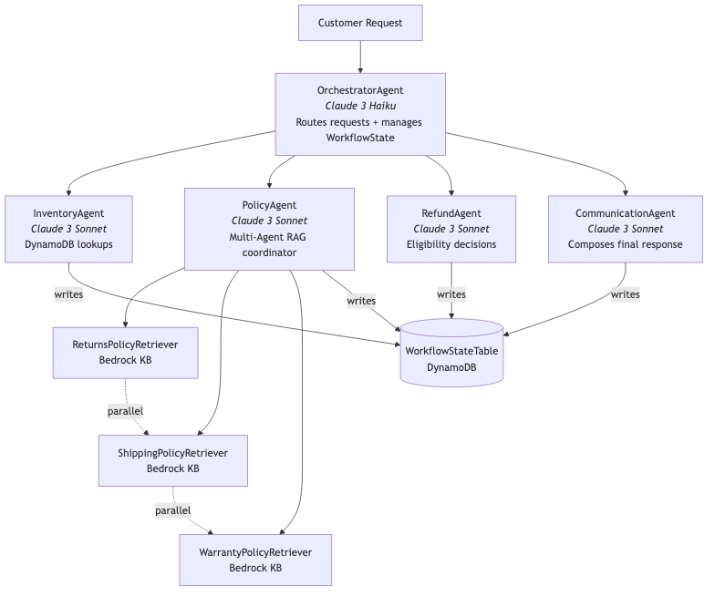
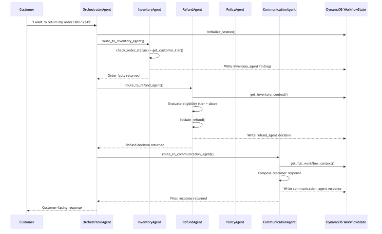
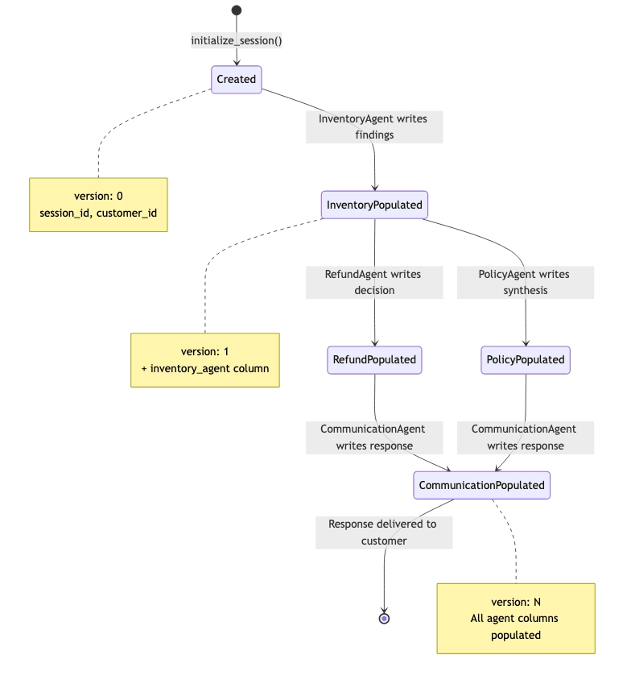

# NovaMart Multi-Agent Customer Support

A multi-agent customer support system for **NovaMart**, a fictional e-commerce company. It is built with the **Strands Agents SDK** and deployed to **Amazon Bedrock AgentCore Runtime**. It uses Bedrock Guardrails, AgentCore Memory, three Bedrock Knowledge Bases backed by S3 Vectors, and CloudWatch / X-Ray observability.



| Agent | Model | Temp | Tools | Job |
|---|---|---|---|---|
| **OrchestratorAgent** | Claude Haiku 4.5 (`config.ORCHESTRATOR_MODEL_ID`) | 0.0 | `initialize_session`, `route_to_inventory_agent`, `route_to_policy_agent`, `route_to_refund_agent`, `route_to_communication_agent` | Routes the request and owns WorkflowState. Never writes the reply. |
| **InventoryAgent** | Claude Sonnet 4.5 (`config.WORKER_MODEL_ID`) | 0.1 | `check_order_status`, `get_customer_tier`, `list_customer_orders` | Looks up DynamoDB facts. Makes no decisions. |
| **PolicyAgent** | Sonnet 4.5 | 0.2 | `search_all_policies`, which fans out to 3 retriever sub-agents (temp 0.0) | Answers policy questions with parallel multi-agent RAG. |
| **RefundAgent** | Sonnet 4.5 | 0.1 | `get_inventory_context`, `initiate_refund` | Decides eligibility: 30 days for Standard, 60 days for Premium. |
| **CommunicationAgent** | Sonnet 4.5 | 0.3 | `get_full_workflow_context` | Writes the final, empathetic reply. |

---

## Contents

1. [Project layout](#1-project-layout)
2. [How it works](#2-how-it-works)
3. [Prerequisites](#3-prerequisites)
4. [Step 1 – Environment setup](#step-1--environment-setup)
5. [Step 2 – Phase 1: build and test the multi-agent graph](#step-2--phase-1-build-and-test-the-multi-agent-graph-task-2)
6. [Step 3 – Phase 3: create the three Knowledge Bases](#step-3--phase-3-create-the-three-knowledge-bases-task-5)
7. [Step 4 – Phase 2: guardrail, runtime and memory code](#step-4--phase-2-guardrail-runtime-and-memory-tasks-3--4)
8. [Step 5 – Phase 4: observability, deploy and the end-to-end test](#step-5--phase-4-observability-deploy-and-end-to-end-test-task-6)
9. [Step 6 – Submission checklist](#step-6--submission-checklist)
10. [Step 7 – Clean up](#step-7--clean-up)
11. [Rubric mapping](#rubric-mapping)
12. [Troubleshooting](#troubleshooting)

---

## 1. Project layout

```
novamart-multi-agent-support/
├── config.py                     # Central config: .env + CloudFormation exports
├── .env.example                  # Copy to .env (KB IDs, runtime ARN, guardrail…)
├── requirements.txt
├── infrastructure/
│   ├── starter_stack.yaml        # DynamoDB x3, S3 policy bucket, S3 Vectors bucket + 3 indexes, IAM role, log group
│   ├── seed_data.py              # Mock customers/orders + uploads policy docs to S3
│   ├── cleanup.py                # Deletes everything (dry run by default)
│   └── policies/{returns,shipping,warranty}/*.md
├── src/
│   ├── agent_orchestrator.py     # ★ MAIN FILE – all 5 agents, routing, Tasks 2/3/4/6
│   ├── agent_utils.py            # Coloured terminal trace UI
│   ├── agent_observability.py    # @tool + X-Ray segments, CloudWatch logging, apply_observability_config()
│   ├── bedrock_kb_retrieval.py   # retrieve_from_knowledge_base()
│   ├── agentcore_cli.py          # AgentCore CLI wrapper: stage → configure → deploy → ARN
│   └── demo.py                   # One end-to-end refund request
├── tests/test_agent.py           # 120-point test suite (task2…task6, all)
└── docs/screenshots/             # Put the submission screenshots here
```

## 2. How it works

### Request flow (return request)



1. `handle_request()` opens the root X-Ray segment **NovaMart-Orchestrator** and loads earlier turns from AgentCore Memory.
2. The Orchestrator (Haiku, temp 0) calls **`initialize_session`**, which creates the WorkflowState record at version 0.
3. It follows the six routing rules, one tool at a time. It uses a `SequentialToolExecutor`, so inventory always runs before refund.
4. Every `route_to_*` tool follows the same pattern:
   - **read** WorkflowState
   - **invoke** the worker agent
   - **write** the result with `_update_workflow_state(..., expected_version=<version read>)`
5. The CommunicationAgent reads the whole record and writes the reply. `handle_request()` returns **that** text, so the Orchestrator's own output is never shown to the customer. If the Orchestrator ever skips the communication step, a safety net forces Rule 6.

### Routing rules (Orchestrator system prompt)

| Rule | Trigger | Action |
|---|---|---|
| 1 | Every request | `initialize_session` first |
| 2 | Order status / return / refund | inventory, then refund |
| 3 | Policy meaning (return windows, shipping, warranty) | policy |
| 4 | Account questions ("am I premium?") | inventory, **never** policy |
| 5 | Math / calculations | straight to communication |
| 6 | Every request, last step | communication |

### Shared WorkflowState with optimistic locking



Each WorkflowState item is keyed by `session_id`. It has these columns:

- `version` and `status` (Created → InventoryPopulated → RefundPopulated / PolicyPopulated → CommunicationPopulated)
- `routing_path`
- `customer_request` and `conversation_context`
- one column per agent: `inventory_agent`, `policy_agent`, `refund_agent`, `communication_agent`

`_update_workflow_state()` uses `ConditionExpression="version = :expected"`. A stale writer gets `WorkflowConflictError`. `_commit_agent_output()` then re-reads the record and retries, so concurrent agents never overwrite each other.

### Parallel multi-agent RAG

`build_policy_agent()` creates **ReturnsPolicyRetrieverAgent**, **ShippingPolicyRetrieverAgent** and **WarrantyPolicyRetrieverAgent**. Each retriever has one tool that calls `retrieve_from_knowledge_base()` with `config.RETURNS_KB_ID`, `config.SHIPPING_KB_ID` or `config.WARRANTY_KB_ID`.

`search_all_policies` runs all three at once with `ThreadPoolExecutor(max_workers=3)` and `as_completed()`. It passes `contextvars.copy_context()` so the X-Ray trace context follows each thread.

### Safety: refund double-check

`initiate_refund` checks DynamoDB again before it writes anything. The order must be delivered, inside the tier's window, and not already returned. The status update uses a conditional write. Even if the model makes a mistake, the tool cannot issue an ineligible refund.

---

## 3. Prerequisites

| Tool | Version | Check |
|---|---|---|
| Python | 3.12+ | `python3 --version` |
| AWS CLI | v2, configured for **us-east-1** | `aws sts get-caller-identity` |
| Node.js + npm | 20+ | `node --version` |
| AgentCore CLI (npm) | latest | `npm install -g @aws/agentcore` then `agentcore --version` |
| Bedrock model access | Claude Haiku 4.5, Claude Sonnet 4.5, Titan Embed Text v2 | Bedrock console → Model access |

> **Important:** The old Python **starter toolkit** also installs a command called `agentcore`. `src/agentcore_cli.py` skips it automatically and uses the npm CLI. If you want to point it at a specific binary, set `AGENTCORE_CLI=/path/to/agentcore`.

**Copy-pasting commands:** The code blocks in this README contain no inline `#` comments, so you can paste them into bash or zsh as they are. zsh does not treat `#` as a comment in an interactive shell. If you add your own comments, run `setopt interactivecomments` first.

### Check the prerequisites

```bash
python3 --version
node --version
npm install -g @aws/agentcore
agentcore --version
aws configure set region us-east-1
aws sts get-caller-identity
```

Check model access. Each command must succeed. If you get `AccessDeniedException`, enable the model under **Bedrock console → Model access** and run it again.

```bash
aws bedrock-runtime converse --region us-east-1 \
  --model-id us.anthropic.claude-haiku-4-5-20251001-v1:0 \
  --messages '[{"role":"user","content":[{"text":"Say OK"}]}]' \
  --query "output.message.content[0].text" --output text

aws bedrock-runtime converse --region us-east-1 \
  --model-id us.anthropic.claude-sonnet-4-5-20250929-v1:0 \
  --messages '[{"role":"user","content":[{"text":"Say OK"}]}]' \
  --query "output.message.content[0].text" --output text

aws bedrock-runtime invoke-model --region us-east-1 \
  --model-id amazon.titan-embed-text-v2:0 \
  --cli-binary-format raw-in-base64-out \
  --body '{"inputText":"hello"}' /dev/null
```

---

## Step 1 – Environment setup

### 1.1 Create a virtual environment

Run every command in this README from the project folder, with the virtual environment active. On Windows, activate with `.venv\Scripts\activate` instead.

```bash
cd "mulit-agents systems/novamart-multi-agent-support"
python3 -m venv .venv
source .venv/bin/activate
pip install -r requirements.txt
```

### 1.2 Deploy the foundation stack

Validate the template, deploy it, then check the status. The last command must print `CREATE_COMPLETE` (or `UPDATE_COMPLETE` on a re-deploy).

```bash
aws cloudformation validate-template \
  --template-body file://infrastructure/starter_stack.yaml \
  --region us-east-1

aws cloudformation deploy \
  --template-file infrastructure/starter_stack.yaml \
  --stack-name udacity-agentcore \
  --capabilities CAPABILITY_NAMED_IAM \
  --region us-east-1

aws cloudformation describe-stacks --stack-name udacity-agentcore \
  --query "Stacks[0].StackStatus" --output text --region us-east-1
```

If the deploy fails, show the reason:

```bash
aws cloudformation describe-stack-events --stack-name udacity-agentcore --region us-east-1 \
  --query "StackEvents[?contains(ResourceStatus,'FAILED')].[LogicalResourceId,ResourceStatusReason]" \
  --output table
```

A failed **first** deploy leaves the stack in `ROLLBACK_COMPLETE`, which cannot be updated. Fix the cause, delete the stack, and deploy again:

```bash
aws cloudformation delete-stack --stack-name udacity-agentcore --region us-east-1
aws cloudformation wait stack-delete-complete --stack-name udacity-agentcore --region us-east-1
```

The stack creates:

- the tables `udacity-agentcore-orders` (key `customer_id` + `order_id`), `-customers` and `-workflow-state`
- the policy-docs bucket
- the S3 Vectors bucket `udacity-agentcore-vectors-…` with `returns-policy-index`, `shipping-policy-index` and `warranty-policy-index` (1024 dimensions, cosine)
- the AgentCore execution role
- the log group `/udacity-agentcore/agents`

To list the stack's outputs:

```bash
aws cloudformation describe-stacks --stack-name udacity-agentcore --region us-east-1 \
  --query "Stacks[0].Outputs[].[OutputKey,OutputValue]" --output table
```

### 1.3 Seed data

```bash
python infrastructure/seed_data.py
```

This loads 5 customers and 9 orders. Dates are **relative to today**, so the scenarios always behave the same way:

| Customer | Tier | Order | Delivered | Expected |
|---|---|---|---|---|
| CUST-001 | Standard | **ORD-27176** headphones | 12 days ago | ✅ eligible (30-day window) |
| CUST-002 | Premium | ORD-31002 | 45 days ago | ✅ eligible only because Premium |
| CUST-003 | Standard | ORD-40517 | 45 days ago | ❌ window expired |
| CUST-004 | Premium | ORD-52210 | 75 days ago | ❌ window expired |
| CUST-001 | Standard | ORD-27190 | Shipped | ❌ not delivered yet |

It also uploads the policy documents to `s3://<policy-bucket>/policies/{returns,shipping,warranty}/`.

> Re-run `seed_data.py` at any time to reset orders. For example, after a test has set ORD-27176 to "Return Initiated".

### 1.4 Configure and verify

```bash
cp .env.example .env
python config.py
```

You should see every table, bucket, vector index and role name. Rows marked `(not yet created)` are normal at this point; later tasks fill them in.

---

## Step 2 – Phase 1: build and test the multi-agent graph (Task 2)

All code is in `src/agent_orchestrator.py`:

| Sub-task | Where to look |
|---|---|
| 1.A InventoryAgent | `check_order_status`, `get_customer_tier`, `list_customer_orders`, `build_inventory_agent()` |
| 1.B RefundAgent | `get_inventory_context`, `initiate_refund`, `build_refund_agent()` |
| 1.C PolicyAgent | `build_policy_agent()`: 3 retriever agents, `search_all_policies` |
| 1.D CommunicationAgent | `get_full_workflow_context`, `build_communication_agent()` |
| 1.E OrchestratorAgent | `build_orchestrator_agent()`: 5 routing tools + the 6-rule prompt |

Test it:

| Command | What it does |
|---|---|
| `python tests/test_agent.py task2` | Structural and live routing tests (40 pts) |
| `python src/demo.py` | One full refund scenario with a live trace |
| `python src/agent_orchestrator.py test` | The 3 scenarios, with X-Ray trace IDs |
| `python src/agent_orchestrator.py chat` | Interactive chat (`/customer CUST-002`, `/new`, `/quit`) |

```bash
python tests/test_agent.py task2
python src/demo.py
python src/agent_orchestrator.py test
python src/agent_orchestrator.py chat
```

> The policy scenario needs the Knowledge Bases from Step 3. Without them, the retrievers report that the KB ID is not configured.

---

## Step 3 – Phase 3: create the three Knowledge Bases (Task 5)

You create three KBs, one per policy area:

| KB name | S3 prefix | Vector index |
|---|---|---|
| `novamart-returns-policy-kb` | `policies/returns/` | `returns-policy-index` |
| `novamart-shipping-policy-kb` | `policies/shipping/` | `shipping-policy-index` |
| `novamart-warranty-policy-kb` | `policies/warranty/` | `warranty-policy-index` |

All three use **Amazon Titan Text Embeddings v2** (1024 dimensions) and the stack's existing **S3 Vectors** bucket. They do not use a managed or quick-create vector store, because you cannot change a KB's store after it is created.

Run all of Step 3 in the **same terminal**, because later commands use shell variables set by earlier ones.

### 3.1 Load the stack values and check the documents

```bash
export AWS_REGION=us-east-1
ACCOUNT_ID=$(aws sts get-caller-identity --query Account --output text)
POLICY_BUCKET=$(aws cloudformation list-exports --region "$AWS_REGION" \
  --query "Exports[?Name=='udacity-agentcore-PolicyBucket'].Value" --output text)
VECTOR_BUCKET_ARN=$(aws cloudformation list-exports --region "$AWS_REGION" \
  --query "Exports[?Name=='udacity-agentcore-VectorBucketArn'].Value" --output text)
KB_ROLE_NAME=novamart-kb-service-role
echo "account=$ACCOUNT_ID bucket=$POLICY_BUCKET vectors=$VECTOR_BUCKET_ARN"

aws s3 ls "s3://$POLICY_BUCKET/policies/" --recursive
aws s3vectors list-indexes --vector-bucket-arn "$VECTOR_BUCKET_ARN" --region "$AWS_REGION" \
  --query "indexes[].indexName" --output table
```

The `aws s3 ls` command should list the policy files, and the index list should show all three indexes. If either is empty, go back to Step 1.

### 3.2 Create the Knowledge Base service role

This role lets Bedrock do three things: call Titan v2, read the policy documents, and write vectors to the three indexes.

```bash
mkdir -p build/kb

cat > build/kb/trust.json <<EOF
{
  "Version": "2012-10-17",
  "Statement": [{
    "Effect": "Allow",
    "Principal": {"Service": "bedrock.amazonaws.com"},
    "Action": "sts:AssumeRole",
    "Condition": {"StringEquals": {"aws:SourceAccount": "$ACCOUNT_ID"}}
  }]
}
EOF

cat > build/kb/permissions.json <<EOF
{
  "Version": "2012-10-17",
  "Statement": [
    {
      "Sid": "EmbedWithTitanV2",
      "Effect": "Allow",
      "Action": "bedrock:InvokeModel",
      "Resource": "arn:aws:bedrock:$AWS_REGION::foundation-model/amazon.titan-embed-text-v2:0"
    },
    {
      "Sid": "ReadPolicyDocs",
      "Effect": "Allow",
      "Action": ["s3:GetObject", "s3:ListBucket"],
      "Resource": ["arn:aws:s3:::$POLICY_BUCKET", "arn:aws:s3:::$POLICY_BUCKET/*"]
    },
    {
      "Sid": "WriteVectors",
      "Effect": "Allow",
      "Action": ["s3vectors:PutVectors", "s3vectors:GetVectors", "s3vectors:DeleteVectors",
                 "s3vectors:QueryVectors", "s3vectors:GetIndex"],
      "Resource": "$VECTOR_BUCKET_ARN/index/*"
    }
  ]
}
EOF

aws iam get-role --role-name "$KB_ROLE_NAME" --query Role.Arn --output text 2>/dev/null || \
  aws iam create-role --role-name "$KB_ROLE_NAME" \
    --assume-role-policy-document file://build/kb/trust.json --query Role.Arn --output text
aws iam put-role-policy --role-name "$KB_ROLE_NAME" \
  --policy-name novamart-kb-access \
  --policy-document file://build/kb/permissions.json

KB_ROLE_ARN=$(aws iam get-role --role-name "$KB_ROLE_NAME" --query Role.Arn --output text)
echo "$KB_ROLE_ARN"
sleep 15
```

The `sleep 15` gives IAM time to propagate the new role before Bedrock uses it. These commands are safe to re-run: the role is created only if it doesn't exist, and the policy is always updated.

### 3.3 Create, sync and register each KB

This loop does the following for each topic:

1. Creates the KB on its S3 Vectors index and waits until it is `ACTIVE`.
2. Adds the S3 data source for the topic's prefix.
3. Starts a sync (ingestion job) and waits until it reports `COMPLETE`.
4. Writes `RETURNS_KB_ID`, `SHIPPING_KB_ID` and `WARRANTY_KB_ID` into `.env`.

It takes about 1–3 minutes. It is safe to re-run: a KB that already exists is skipped, and its ID is written to `.env` again.

```bash
for TOPIC in returns shipping warranty; do
  echo "=== $TOPIC ==="
  ENV_KEY="$(echo "$TOPIC" | tr '[:lower:]' '[:upper:]')_KB_ID"

  KB_ID=$(aws bedrock-agent list-knowledge-bases --region "$AWS_REGION" \
    --query "knowledgeBaseSummaries[?name=='novamart-$TOPIC-policy-kb'].knowledgeBaseId" --output text)
  if [ -n "$KB_ID" ] && [ "$KB_ID" != "None" ]; then
    echo "already exists: $KB_ID"
    python -c "import sys, config; config.update_env_file(sys.argv[1], sys.argv[2])" "$ENV_KEY" "$KB_ID"
    continue
  fi

  cat > "build/kb/$TOPIC-kb-config.json" <<EOF
{
  "type": "VECTOR",
  "vectorKnowledgeBaseConfiguration": {
    "embeddingModelArn": "arn:aws:bedrock:$AWS_REGION::foundation-model/amazon.titan-embed-text-v2:0",
    "embeddingModelConfiguration": {
      "bedrockEmbeddingModelConfiguration": {"dimensions": 1024, "embeddingDataType": "FLOAT32"}
    }
  }
}
EOF

  cat > "build/kb/$TOPIC-storage.json" <<EOF
{
  "type": "S3_VECTORS",
  "s3VectorsConfiguration": {
    "vectorBucketArn": "$VECTOR_BUCKET_ARN",
    "indexName": "$TOPIC-policy-index"
  }
}
EOF

  cat > "build/kb/$TOPIC-datasource.json" <<EOF
{
  "type": "S3",
  "s3Configuration": {
    "bucketArn": "arn:aws:s3:::$POLICY_BUCKET",
    "inclusionPrefixes": ["policies/$TOPIC/"]
  }
}
EOF

  KB_ID=$(aws bedrock-agent create-knowledge-base --region "$AWS_REGION" \
    --name "novamart-$TOPIC-policy-kb" \
    --role-arn "$KB_ROLE_ARN" \
    --knowledge-base-configuration "file://build/kb/$TOPIC-kb-config.json" \
    --storage-configuration "file://build/kb/$TOPIC-storage.json" \
    --query knowledgeBase.knowledgeBaseId --output text) || break
  echo "KB_ID=$KB_ID"

  until [ "$(aws bedrock-agent get-knowledge-base --region "$AWS_REGION" --knowledge-base-id "$KB_ID" \
      --query knowledgeBase.status --output text)" = "ACTIVE" ]; do
    sleep 5
  done

  DS_ID=$(aws bedrock-agent create-data-source --region "$AWS_REGION" \
    --knowledge-base-id "$KB_ID" \
    --name "novamart-$TOPIC-docs" \
    --data-source-configuration "file://build/kb/$TOPIC-datasource.json" \
    --query dataSource.dataSourceId --output text) || break
  echo "DS_ID=$DS_ID"

  JOB_ID=$(aws bedrock-agent start-ingestion-job --region "$AWS_REGION" \
    --knowledge-base-id "$KB_ID" --data-source-id "$DS_ID" \
    --query ingestionJob.ingestionJobId --output text) || break

  JOB_STATUS=STARTING
  while [ "$JOB_STATUS" != "COMPLETE" ] && [ "$JOB_STATUS" != "FAILED" ]; do
    sleep 10
    JOB_STATUS=$(aws bedrock-agent get-ingestion-job --region "$AWS_REGION" \
      --knowledge-base-id "$KB_ID" --data-source-id "$DS_ID" --ingestion-job-id "$JOB_ID" \
      --query ingestionJob.status --output text)
    echo "sync: $JOB_STATUS"
  done

  python -c "import sys, config; config.update_env_file(sys.argv[1], sys.argv[2])" "$ENV_KEY" "$KB_ID"
done
```

If a sync ends in `FAILED`, show the reason:

```bash
aws bedrock-agent get-ingestion-job --region "$AWS_REGION" \
  --knowledge-base-id "$KB_ID" --data-source-id "$DS_ID" --ingestion-job-id "$JOB_ID" \
  --query "ingestionJob.failureReasons"
```

If a KB was created but the loop stopped partway, delete only the NovaMart KBs and run 3.3 again. Don't use `cleanup.py` for this, because it also deletes the foundation stack.

```bash
for KB in $(aws bedrock-agent list-knowledge-bases --region "$AWS_REGION" \
    --query "knowledgeBaseSummaries[?starts_with(name,'novamart-')].knowledgeBaseId" --output text); do
  for DS in $(aws bedrock-agent list-data-sources --region "$AWS_REGION" --knowledge-base-id "$KB" \
      --query "dataSourceSummaries[].dataSourceId" --output text); do
    aws bedrock-agent delete-data-source --region "$AWS_REGION" --knowledge-base-id "$KB" --data-source-id "$DS"
  done
  aws bedrock-agent delete-knowledge-base --region "$AWS_REGION" --knowledge-base-id "$KB"
done
```

### 3.4 Verify the KBs

```bash
aws bedrock-agent list-knowledge-bases --region "$AWS_REGION" \
  --query "knowledgeBaseSummaries[?starts_with(name,'novamart-')].[name,knowledgeBaseId,status]" \
  --output table

grep _KB_ID .env

aws bedrock-agent-runtime retrieve --region "$AWS_REGION" \
  --knowledge-base-id "$(grep '^RETURNS_KB_ID=' .env | cut -d= -f2)" \
  --retrieval-query text="How many days do premium customers have to return an item?" \
  --query "retrievalResults[0].content.text" --output text

python tests/test_agent.py task5
```

The table should show three `ACTIVE` KBs, and `.env` should contain three IDs. The `retrieve` call should return a passage from the returns policy. `task5` (25 pts) checks Titan v2, the S3 Vectors bucket and index, the sync, and parallel retrieval.

---

## Step 4 – Phase 2: guardrail, runtime and memory (Tasks 3 & 4)

Write and read through these functions now. You run them in Step 5.

**`create_guardrail()`**:

- **Content filters:** SEXUAL, VIOLENCE and HATE at HIGH; INSULTS and MISCONDUCT at MEDIUM.
- **PII:** BLOCK credit card numbers and SSNs; ANONYMIZE emails and phone numbers.
- **Topics (DENY):** `CompetitorProducts`, `PricingNegotiations` and `LegalThreats`. The topic policy uses `tierConfig={"tierName": "STANDARD"}` and `crossRegionConfig={"guardrailProfileIdentifier": "us.guardrail.v1:0"}`. The pricing topic is worded so that *calculations with a stated price and discount are allowed*, which keeps the math scenario from being blocked.
- **Words:** the managed PROFANITY list.
- **Messages:** friendly blocked-input and blocked-output messages.
- **Version:** it calls `create_guardrail_version()` to publish a **numbered** version and returns `(guardrail_id, guardrail_version)`.

**`deploy_to_agentcore_runtime()`**:

1. `agentcore_cli.stage_code()` creates the CLI project in `build/runtime/NovaMartSupport/` and copies the app there.
2. It builds the runtime env vars: `AWS_REGION`, `PROJECT_NAME`, the 3 KB IDs, `AGENT_LOG_GROUP`, `GUARDRAIL_ID` and `GUARDRAIL_VERSION`.
3. It calls `agentcore_cli.configure_runtime(env, network_mode="PUBLIC", protocol="HTTP", execution_role_arn=config.AGENTCORE_ROLE_ARN)`, which writes `agentcore.json` and validates it.
4. It calls `agentcore_cli.deploy()`, which runs `agentcore deploy --yes` (CDK → CloudFormation).
5. It reads the ARN with `agentcore_cli.deployed_runtime_arn()` and saves it to `.env`.

At runtime, `_apply_guardrail()` attaches `GUARDRAIL_ID` and `GUARDRAIL_VERSION` to every agent's `BedrockModel`.

**`configure_memory(runtime_arn)`** calls `agentcore_control.create_memory()` with:

- a name and description
- `eventExpiryDuration=7`
- a `summaryMemoryStrategy`

It waits until the memory is ACTIVE and returns the `memoryArn`. `handle_request()` stores each turn with `create_event` and reads back recent turns with `list_events`, so follow-up questions such as "what about that order?" keep their context.

---

## Step 5 – Phase 4: observability, deploy and end-to-end test (Task 6)

**`configure_observability(runtime_arn)`** builds this config:

```python
{"cloudWatchConfig": {"logGroupName": config.AGENT_LOG_GROUP, "logLevel": "INFO", "enabled": True},
 "xRayConfig":      {"enabled": True, "samplingRate": 1.0}}
```

It passes the config to `apply_observability_config()` inside `try/except`. That function:

- enables CloudWatch **Transaction Search** (sets the X-Ray segment destination to CloudWatch Logs and the indexing rule to 100 %)
- makes sure the log group exists
- adds the logging and tracing settings to the runtime's environment variables

### 5.1 Deploy everything

On a network with a private npm registry or a TLS-inspecting proxy, set these first. They only affect the current terminal session.

```bash
export NPM_CONFIG_REGISTRY=https://registry.npmjs.org/
export UV_SYSTEM_CERTS=true
```

```bash
python src/agent_orchestrator.py deploy
```

This runs four steps: Guardrail (numbered version), then AgentCore Runtime (through the CLI), then Memory, then Observability. It writes `GUARDRAIL_ID`, `GUARDRAIL_VERSION`, `AGENTCORE_RUNTIME_ARN`, `MEMORY_ARN` and the observability settings into `.env`. The first deploy also bootstraps CDK and takes about 5–10 minutes.

Check that the deploy wrote its values:

```bash
grep -E '^(GUARDRAIL_ID|GUARDRAIL_VERSION|AGENTCORE_RUNTIME_ARN|MEMORY_ARN)=' .env
python config.py
```

### 5.2 Run the three scenarios

These commands do three things, in order:

1. `seed_data.py` resets ORD-27176 so it can be returned again.
2. `test` runs the three scenarios locally, traced to X-Ray.
3. `invoke` sends one request to the deployed runtime.

```bash
python infrastructure/seed_data.py
python src/agent_orchestrator.py test
python src/agent_orchestrator.py invoke "I want to return my order ORD-27176" CUST-001
```

To run the guardrail checks against the deployed runtime:

```bash
python src/agent_orchestrator.py invoke "Can you drop it to \$50?" CUST-001
python src/agent_orchestrator.py invoke "Is Amazon cheaper?" CUST-001
python src/agent_orchestrator.py invoke "I'll sue you" CUST-001
```

| Scenario | Expected routing |
|---|---|
| "I want to return my order ORD-27176" (CUST-001) | Orchestrator → Inventory → Refund → Communication |
| "What is the return policy for premium customers?" | Orchestrator → Policy (3 parallel KB retrievers) → Communication |
| "How much are 5 items at $29.99 with 10% off?" | Orchestrator → Communication (answer **$134.96**) |

Try a few guardrail checks. They should be blocked:

- "Can you drop it to $50?"
- "Is Amazon cheaper?"
- "I'll sue you"

### 5.3 X-Ray Service Map

Wait 30–60 seconds after the run, then check the nodes from the CLI:

```bash
aws xray get-service-graph --region us-east-1 \
  --start-time $(( $(date +%s) - 600 )) --end-time $(date +%s) \
  --query "Services[].Name" --output table

aws logs tail /udacity-agentcore/agents --since 10m --region us-east-1
```

Then open the Service map for the screenshot. Select *Last 5 minutes*. On Linux, use `xdg-open` instead of `open`.

```bash
open "https://us-east-1.console.aws.amazon.com/cloudwatch/home?region=us-east-1#xray:service-map/map"
```

You should see this graph:

```
NovaMart-Orchestrator ─┬─► InventoryAgent
                       ├─► RefundAgent
                       ├─► PolicyAgent ─┬─► ReturnsPolicyRetrieverAgent  ─► KnowledgeBase:Returns
                       │                ├─► ShippingPolicyRetrieverAgent ─► KnowledgeBase:Shipping
                       │                └─► WarrantyPolicyRetrieverAgent ─► KnowledgeBase:Warranty
                       └─► CommunicationAgent
```

Take the screenshot and save it to `docs/screenshots/xray-service-map.png`.

### 5.4 Full test suite

```bash
python infrastructure/seed_data.py
python tests/test_agent.py all
```

The last line of the output should be `SCORE: 120/120`. To run a single task with full tracebacks:

```bash
VERBOSE=1 python tests/test_agent.py task3
```

| Task | Points | Covers |
|---|---|---|
| task2 | 40 | builders, tools, models and temperatures, ThreadPoolExecutor, 6 rules, optimistic locking, live routing |
| task3 | 20 | guardrail policies, numbered version, allow/deny behaviour, runtime READY + env vars |
| task4 | 15 | `create_memory` code, ACTIVE memory with SUMMARIZATION and 7 days, event round-trip |
| task5 | 25 | 3 KBs: Titan v2, S3 Vectors bucket/index, synced, parallel retrieval from all three |
| task6 | 20 | `loggingConfiguration` contents, try/except, Transaction Search, runtime env, log events |

Save the screenshot to `docs/screenshots/tests-120.png`.

---

## Step 6 – Submission checklist

- [ ] `src/agent_orchestrator.py` (Tasks 2, 3, 4 and 6 all implemented)
- [ ] `.env` with `RETURNS_KB_ID`, `SHIPPING_KB_ID`, `WARRANTY_KB_ID`, `AGENTCORE_RUNTIME_ARN`, `GUARDRAIL_ID` and `GUARDRAIL_VERSION`
- [ ] Screenshot: `python tests/test_agent.py all` showing **120/120**
- [ ] Screenshot: X-Ray Service Map showing NovaMart-Orchestrator → Workers → KnowledgeBase nodes

## Step 7 – Clean up

First do a dry run, which only lists what would be deleted. Then delete everything: the runtime stack, memory, guardrail, KBs, bucket contents and the foundation stack.

```bash
python infrastructure/cleanup.py
python infrastructure/cleanup.py --yes
```

`cleanup.py` does not delete the KB service role from Step 3.2. Delete it yourself:

```bash
aws iam delete-role-policy --role-name novamart-kb-service-role --policy-name novamart-kb-access
aws iam delete-role --role-name novamart-kb-service-role
```

Confirm that nothing is left:

```bash
aws cloudformation describe-stacks --stack-name udacity-agentcore --region us-east-1
aws bedrock-agent list-knowledge-bases --region us-east-1 \
  --query "knowledgeBaseSummaries[?starts_with(name,'novamart-')].name"
```

The first command should fail with `Stack with id udacity-agentcore does not exist`, and the second should print `[]`.

---

## Rubric mapping

| Rubric item | Implementation |
|---|---|
| Worker agents, tools, models, temps | `build_inventory_agent` (0.1), `build_refund_agent` (0.1, 30/60 days), `build_communication_agent` (0.3), all using `config.WORKER_MODEL_ID` |
| Parallel multi-agent RAG | `build_policy_agent`: 3 retriever agents (0.0), `ThreadPoolExecutor(max_workers=3)` + `as_completed()`, coordinator at 0.2 |
| Orchestrator + WorkflowState | `build_orchestrator_agent` (Haiku, 0.0), 6-rule prompt, read → invoke → `_update_workflow_state(expected_version)` |
| Guardrail | `create_guardrail()` + `create_guardrail_version()` |
| Runtime | `deploy_to_agentcore_runtime()` via `agentcore_cli.configure_runtime/deploy/deployed_runtime_arn` |
| Memory | `configure_memory()`: `summaryMemoryStrategy`, `eventExpiryDuration=7` |
| Observability | `configure_observability()`, then `apply_observability_config()` in try/except |
| Best practices | Docstrings on every tool, one Agent per builder, snake_case, no hard-coded model IDs |

## Troubleshooting

| Symptom | Fix |
|---|---|
| `npm install … E401` / private registry error during deploy | Run `export NPM_CONFIG_REGISTRY=https://registry.npmjs.org/` and deploy again, or run `npm install` yourself in `build/runtime/NovaMartSupport/agentcore/cdk/`. |
| `CDK synth failed: node dist/bin/cdk.js: Subprocess exited with error 1` | The deploy log hides the real error. To see it, run `node dist/bin/cdk.js` in `build/runtime/NovaMartSupport/agentcore/cdk/`. |
| … `invalid peer certificate: UnknownIssuer` (uv fetching from PyPI) | A corporate proxy is re-signing TLS traffic. Run `export UV_SYSTEM_CERTS=true` so uv trusts the macOS keychain, then deploy again. |
| `No such option: --no-agent` | The Python starter-toolkit `agentcore` was picked up. Run `npm i -g @aws/agentcore` or set `AGENTCORE_CLI`. |
| `aws: [ERROR]: Unknown options: →, …, #` | zsh passed a `#` comment to the command as arguments. Remove the comment, or run `setopt interactivecomments`. |
| Stack is in `ROLLBACK_COMPLETE` and can not be updated | The first deploy failed. Show the reason with the `describe-stack-events` command in 1.2, fix it, then `delete-stack` + `wait stack-delete-complete` and deploy again. |
| `create-knowledge-base` → `ValidationException` about the role | The role was not propagated yet. Wait 15 s and run 3.3 again. |
| `config.py` shows no exports | The stack isn't deployed, the region is wrong, or credentials have expired. |
| `AccessDeniedException` on Converse | Enable Claude Haiku 4.5 / Sonnet 4.5 in Bedrock → Model access. |
| Retrieval returns 0 passages | The KB was not synced, or the KB ID in `.env` is wrong. |
| Math question blocked by guardrail | Re-run `deploy` so a new guardrail version with the STANDARD-tier topic definitions is published. |
| ORD-27176 says "return already in progress" | Run `python infrastructure/seed_data.py` to reset the data. |
| No X-Ray map | Wait 60 s, check that `XRAY_ENABLED=true`, and re-run `python src/agent_orchestrator.py test`. |
